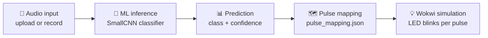

<div align="center">

# 🔊 KARNA

### AI-Based Environmental Sound Awareness with Simulated Haptic Alerts

*Hear the world through touch: classify important sounds, then translate them into haptic pulse patterns.*


**CodeQuest · Accessibility + TinyML · Vellore Institute of Technology Bhopal**

</div>

---

## 🚀 Live Demo

<!-- TODO: replace the placeholder links below before submission -->

| | |
|---|---|
| 🎬 **Demo link** | **[ DEMO LINK ](https://drive.google.com/file/d/1-fzrobiXzHrAxXcYv0r33y48VveT8NVY/view?usp=sharing)** |
| 📘 **Setup guide** | **[SETUP.md](SETUP.md)** (complete instructions for running the project) |

> 👉 **New here?** Open **[SETUP.md](SETUP.md)** first. It walks through installing dependencies and running the project step by step.

---

## 📖 About

People who are deaf or hard of hearing may not notice important environmental or emergency sounds through hearing alone. **KARNA** explores an alternative alert channel: it **classifies the sound** and represents it as a **tactile pulse pattern** that a wearable haptic wristband could deliver.

The current MVP demonstrates the full software workflow:



> **Scope note:** The Wokwi LED is only a simulation aid that makes the pulse sequence visible. The intended end product is a wearable haptic wristband. No physical wristband or vibration motor is connected in this MVP.

---

## ✨ Features

- 🎧 **Audio input:** upload a recorded file or record through the laptop microphone in the Streamlit frontend
- 🧠 **Sound classification:** mono and stereo CNN model inference
- 📈 **Rich output:** predicted class, confidence, and top-three predictions
- 🗺️ **Pulse mapping:** each class maps to a stable pattern ID (`P01`–`P12`) through `pulse_mapping.json`
- 📦 **Structured events:** JSON pulse events ready for simulator integration
- 💡 **Wokwi demo:** the mapped pulse sequence is shown as LED blinks

---

## 🔔 Supported Sound Classes

12 classes covering emergency vehicles, traffic and nine horn scenarios:

| Emergency & environment | Long horn | Short horn | Varied horn |
|---|---|---|---|
| `ambulance_siren` | `long_horn_ahead` | `short_horn_ahead` | `varied_horn_ahead` |
| `fire_truck_siren` | `long_horn_alongside` | `short_horn_alongside` | `varied_horn_alongside` |
| `traffic_noise` | `long_horn_behind` | `short_horn_behind` | `varied_horn_behind` |

---

## ⚙️ How It Works

**Preprocessing**

1. Load WAV audio (mono or stereo)
2. Resample to **16 kHz**
3. Pad or trim to **3 seconds**
4. Compute a **64-bin log-Mel** spectrogram (FFT size 1,024, hop length 256)

**Model:** a `SmallCNN` (convolutional layers, pooling, final classification layer), available as mono and stereo variants.

**Pulse event:** after inference, the predicted class is looked up in `pulse_mapping.json`. The generated event contains:

- Predicted sound class
- Prediction confidence
- Top-three model predictions
- Pattern ID
- Pulse count
- Pulse duration
- Pause duration

---

## 🏁 Quick Start

For the complete walkthrough, see **[SETUP.md](SETUP.md)**.

```bash
# 1. Install dependencies
pip install -r requirements.txt

# 2. Run inference on a WAV file (mono model)
python pulse_bridge.py --audio "path/to/audio.wav" --model mono

# 3. Or use the stereo model
python pulse_bridge.py --audio "path/to/audio.wav" --model stereo
```

Save separate output events:

```bash
python pulse_bridge.py --audio "path/to/audio.wav" --model mono   --output "pulse_events/mono_event.json"
python pulse_bridge.py --audio "path/to/audio.wav" --model stereo --output "pulse_events/stereo_event.json"
```

The default output location is `pulse_events/latest_event.json`.

The inference bridge uses **PyTorch**, **torchaudio** and **SoundFile**. To launch the Streamlit frontend (upload or microphone recording), follow the steps in **[SETUP.md](SETUP.md)**.

---

## 📊 Models and Evaluation

Two model configurations were evaluated on the same dataset split.

| Metric | Mono model | Stereo model |
|---|---:|---:|
| Validation accuracy | 75.13% | 74.62% |
| Clean validation macro F1 | 67.20% | 66.49% |
| Clean test accuracy | 61.11% | 61.11% |
| Clean test macro F1 | 41.85% | 42.49% |
| Noisy test accuracy | 52.38% | 54.17% |
| Noisy test emergency-only macro F1 | 36.09% | 39.66% |

The mono model is the primary baseline because stereo did not show a decisive overall advantage. The stereo checkpoint is retained as an experimental alternative.

> ⚠️ These are multi-class results across 12 classes. The noisy emergency-class macro F1 excludes `traffic_noise`, which had zero samples in the noisy test set. Generalisation on unseen recordings still needs improvement, and these results should **not** be read as proof of reliable real-world emergency detection.

### Dataset and training setup

| Dataset version | Training | Validation | Test | Total |
|---|---:|---:|---:|---:|
| Clean (original) clips | 737 | 197 | 198 | 1,132 |
| Traffic-augmented entries | 597 | 167 | 168 | 932 |

- Horn clips are split by horn scenario
- Optimizer: AdamW, up to 35 epochs, with early stopping
- Traffic augmentation is explicitly incorporated into the emergency training scripts
- Clean and traffic-noisy evaluation reports include per-class F1 and confusion matrices

---

## 🗂️ Project Structure

```
karna/
│
├── app.py                      # Streamlit frontend entry point
├── pulse_bridge.py             # Inference → pulse event bridge
├── pulse_mapping.json          # Class → pattern ID mapping
├── send_to_esp32.py            # ESP32 communication script
├── train_emergency.py          # Mono training
├── train_emergency_stereo.py   # Stereo training
├── SETUP.md                    # Complete setup instructions
├── README.md
├── requirements.txt
│
├── datasets/
│   ├── emergency_audio.py
│   ├── emergency_audio_stereo.py
│   └── other dataset loaders
│
├── models/
│   ├── small_cnn.py
│   └── small_cnn_stereo.py
│
├── transforms/
│   └── audio.py
│
├── artifacts/
│   ├── emergency_mono_control/
│   │   ├── best_emergency_1ch_model.pt
│   │   └── class_map.json
│   └── emergency_stereo/
│       ├── best_emergency_2ch_model.pt
│       └── class_map.json
│
├── emergency_datset/
│   ├── Dataset/                # Original audio dataset (not committed)
│   ├── dataset_preparation/
│   ├── audit reports/          # Generated reports (not committed)
│   └── preparation scripts
│
└── pulse_events/
    ├── mono_event.json
    └── stereo_event.json
```

Other existing source files and scripts (`tests/`, `utils/`, `docs/`, `examples/`) remain part of the repository.

---

## 🚧 Current Limitations

- The inference bridge takes prerecorded WAV audio; continuous microphone streaming is not implemented in the bridge (microphone recording is available in the Streamlit frontend)
- The LED in Wokwi is a simulation aid; no physical haptic hardware actuation is implemented
- Pulse timings and counts are pending simulator/hardware validation
- Classification performance, particularly for horn direction and unseen recordings, needs further improvement
- Real-world testing in varied traffic and emergency environments remains necessary

## 🛣️ Roadmap

- [x] Audio input, ML classification and prediction display
- [x] Class-to-pattern mapping and structured JSON pulse events
- [x] Wokwi LED pulse demonstration
- [ ] On-device inference on the **ESP32** (TinyML)
- [ ] Wearable haptic wristband with vibration motor
- [ ] Improved noise robustness and dataset diversity
- [ ] End-to-end testing with real users and varied acoustic conditions

---

## 👥 Team

| Name | Role |
|---|---|
| **Aditi Singh** | Team member ([@aditi25bce10868-blip](https://github.com/aditi25bce10868-blip)) |
| **Kartiki Sinha** | Team member ([@kartiki0506](https://github.com/kartiki0506)) |

**Event:** CodeQuest · **Theme:** Accessibility + TinyML · **Institution:** Vellore Institute of Technology Bhopal

Built on top of the live audio classifier codebase by [@dmanzato](https://github.com/dmanzato).

## 📄 License

Released under the [MIT License](LICENSE).
